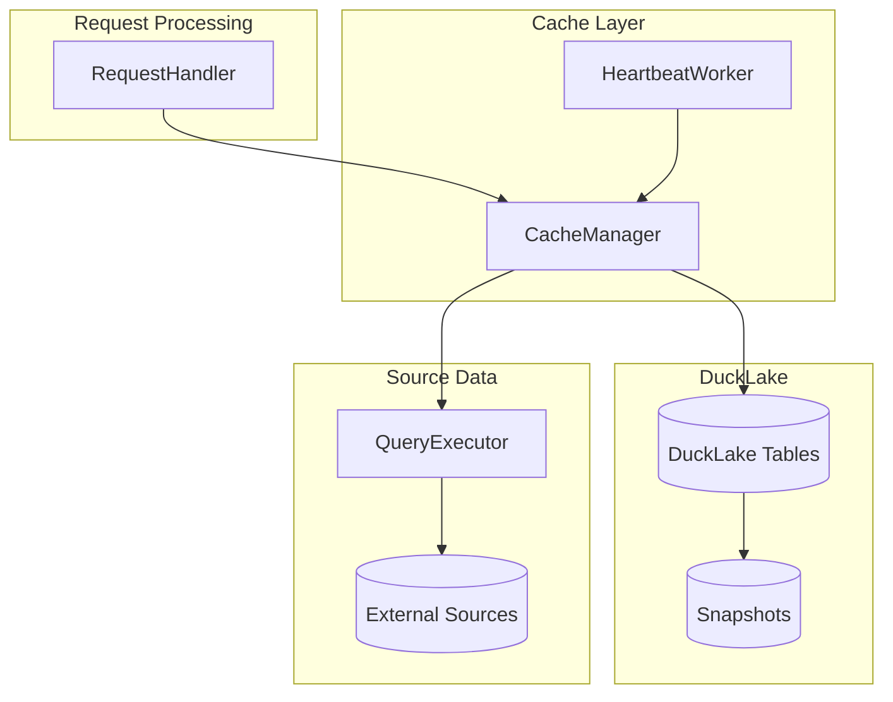
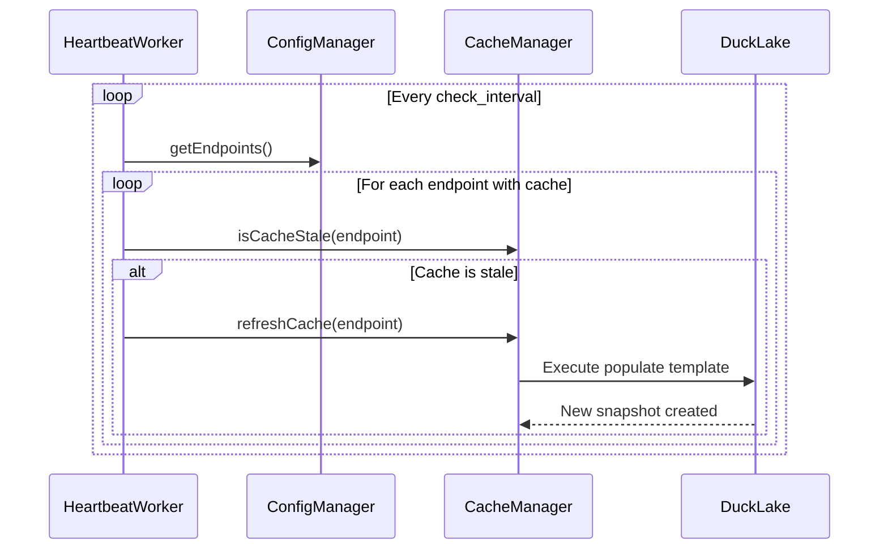
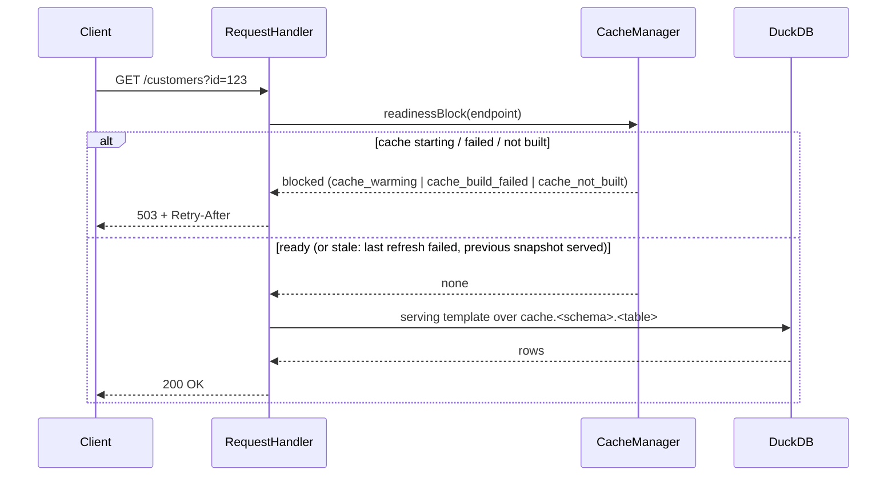

# Caching System

This document describes the DuckLake-based caching architecture in flAPI.

## Overview

flAPI uses DuckLake for result caching, providing:
- Snapshot-based table versioning
- Time-travel queries for rollback
- Efficient incremental refresh
- Scheduled background refresh

## Architecture



## CacheManager

`CacheManager` (src/cache_manager.cpp) handles all cache operations.

### Key Methods

```cpp
class CacheManager {
public:
    // Check if cache is enabled and valid
    bool isCacheEnabled(const EndpointConfig& endpoint) const;
    bool isCacheValid(const EndpointConfig& endpoint) const;

    // Cache operations
    QueryResult getCachedResult(const EndpointConfig& endpoint,
                                const std::map<std::string, std::string>& params);
    void updateCache(const EndpointConfig& endpoint, const QueryResult& result);
    bool invalidateCache(const EndpointConfig& endpoint);

    // Refresh operations
    void refreshCache(const EndpointConfig& endpoint);
    void refreshAllCaches();

    // Snapshot management
    std::vector<SnapshotInfo> getSnapshots(const std::string& table) const;
    void pruneSnapshots(const std::string& table, const RetentionConfig& retention);
};
```

## Cache Configuration

### Endpoint Cache Config

```yaml
cache:
  enabled: true
  table: customers_cache       # Cache table name
  schema: cache                # Schema (default: cache)
  schedule: "1h"               # Refresh interval
  primary-key: [id]            # For merge operations
  cursor:
    column: updated_at         # Change tracking column
    type: timestamp
  retention:                   # replaces ducklake.retention for this cache (no merge)
    keep-last-snapshots: 10    # Max snapshots to keep
    max-snapshot-age: "7d"     # Max age of snapshots
  invalidate-on-write: true    # Refresh synchronously before a write's response
  refresh-on-write: false      # Refresh asynchronously after a write's response
  template-file: customers_cache.sql  # The populate SQL
```

### Global DuckLake Config

```yaml
ducklake:
  enabled: true
  alias: cache                 # Database alias
  metadata-path: ./cache/metadata
  data-path: ./cache/data
  retention:                   # default for caches without their own retention
    keep-last-snapshots: 100
    max-snapshot-age: "30d"
  compaction:
    enabled: true
    schedule: "24h"            # interval, or @hourly / @daily / @midnight / @weekly
    delete-threshold: 0.05     # ~ refreshes between compactions x delta share (DuckLake default 0.95)
  scheduler:
    enabled: true              # the default; false opts out (startup warns)
    scan-interval: "1m"        # default: min(heartbeat.worker-interval, shortest cache.schedule)
```

An invalid `compaction.schedule` or `scheduler.scan-interval` stops startup, as
does a `heartbeat.worker-interval` <= 0 (default 60 s).

## Cache Modes

### Full Refresh

Replaces entire cache table on each refresh:

```sql
-- Cache populate template (full refresh). A bare SELECT is refused before it
-- runs, and the cache table must exist after the script or the refresh rolls back.
CREATE OR REPLACE TABLE {{cache.catalog}}.{{cache.schema}}.{{cache.table}} AS
SELECT * FROM read_parquet('{{{ conn.path }}}')
```

**Use when:**
- Small datasets
- Complete data replacement needed
- Simple implementation preferred

### Incremental Append

Adds new rows since last refresh:

```sql
-- Cache populate template (incremental append)
-- First run: no watermark, so create the (empty) table before inserting.
{{^cache.previousSnapshotTimestamp}}
CREATE TABLE IF NOT EXISTS {{cache.catalog}}.{{cache.schema}}.{{cache.table}} AS
SELECT * FROM source_table WHERE false;
{{/cache.previousSnapshotTimestamp}}
INSERT INTO {{cache.catalog}}.{{cache.schema}}.{{cache.table}}
SELECT * FROM source_table
WHERE 1=1
{{#cache.previousSnapshotTimestamp}}
  AND created_at > TIMESTAMP '{{{cache.previousSnapshotTimestamp}}}'
{{/cache.previousSnapshotTimestamp}};
```

**Use when:**
- Append-only data (logs, events)
- Large datasets
- Fast refresh needed

### Incremental Merge

Handles inserts, updates, and deletes:

```sql
-- Cache populate template (incremental merge)
{{^cache.previousSnapshotTimestamp}}
CREATE TABLE IF NOT EXISTS {{cache.catalog}}.{{cache.schema}}.{{cache.table}} AS
SELECT * FROM source_table WHERE false;
{{/cache.previousSnapshotTimestamp}}
MERGE INTO {{cache.catalog}}.{{cache.schema}}.{{cache.table}} AS target
USING (
    SELECT * FROM source_table
    WHERE 1=1
    {{#cache.previousSnapshotTimestamp}}
    AND updated_at > TIMESTAMP '{{{cache.previousSnapshotTimestamp}}}'
    {{/cache.previousSnapshotTimestamp}}
) AS source
ON target.id = source.id
WHEN MATCHED THEN UPDATE SET *
WHEN NOT MATCHED THEN INSERT *
```

**Use when:**
- Rows are updated in place (customers, orders)
- Deletes are visible in the source (a soft-delete flag or `deleted_at` that
  bumps the cursor). DuckLake's `MERGE` accepts only one `UPDATE`/`DELETE`
  action, so a `DELETE` arm next to the `UPDATE` arm fails; delete in a
  separate `DELETE … WHERE id IN (<deleted delta>)` before the `MERGE`, or keep
  tombstones and filter them when serving
  ([guides/caching.md](../../guides/caching.md#deletes-in-merge-mode)).
  A hard delete leaves no row for the delta to carry, so it is invisible to
  any incremental mode.

## Cache Template Variables

| Variable | Description |
|----------|-------------|
| `{{cache.table}}` | Cache table name |
| `{{cache.schema}}` | Cache schema name |
| `{{cache.catalog}}` | Cache catalog (DuckLake alias) |
| `{{cache.previousSnapshotTimestamp}}` | Incremental watermark: `max(<cursor>)` over the cached rows when a `cursor:` is configured, else the last refresh's commit timestamp. See CONFIG_REFERENCE for why the commit timestamp alone loses rows. |
| `{{cache.snapshotTimestamp}}` / `{{cache.snapshotId}}` | The table's newest snapshot when this refresh started (the last refresh that wrote it); kept with `--full` |
| `{{cache.previousSnapshotId}}` | The same snapshot id (for time travel); kept when only the cursor watermark is dropped, erased with `--full` |
| `{{cache.cursorColumn}}` / `{{cache.cursorType}}` | The declared cursor |
| `{{cache.primaryKeys}}` | The declared primary key, comma-joined |
| `{{cache.schedule}}` | The declared schedule |
| `{{params.cacheMode}}` | `full`, `append` or `merge` |

## HeartbeatWorker

`HeartbeatWorker` (src/heartbeat_worker.cpp) runs background cache refresh.
It runs two cadences on one thread: endpoint heartbeats every
`heartbeat.worker-interval` (default 60 s), and cache schedules every scan
interval (`ducklake.scheduler.scan-interval`, default
`min(worker-interval, shortest cache.schedule)`, floor 1 s). The scheduler is
on unless `ducklake.scheduler.enabled: false`. Startup logs `Cache scheduler on:
N scheduled cache(s), checked every X s` and warns for any schedule shorter than
the scan interval. Endpoints that share a cache table share one schedule.

There is no refresh at boot: a cache is due one `schedule` after its last real
refresh, which is this run's warm-up, else the table's newest snapshot, else
process start. Refreshes through the config service count. Compaction
(`ducklake.compaction`, enabled + schedule) runs once per catalog when due
(`merge_adjacent_files`, `rewrite_data_files`, cleanup), writes an audit row with
`sync_type` `compaction`, and its due time survives restarts.

### Two background paths, both direct

The worker loop drives two independent things per tick, and **neither goes
through the HTTP router**:

| Path | Entry point | Applies to |
|------|-------------|------------|
| Endpoint warm-up | `APIServer::warmEndpoint()` → `RequestHandler::handleRequest()` | every endpoint with `heartbeat.enabled: true`, cached or not |
| DuckLake schedule | `CacheManager::refreshCache()` | every endpoint with `cache.schedule` |

The warm-up runs the endpoint's whole read path as a synthetic GET (connection,
extensions, template render, query) and discards the result, so a cache-backed
endpoint is refreshed and an uncached one is merely warmed. It passes
`endpoint.heartbeat.params` as the template parameters.

`warmEndpoint()` replaced `requestForEndpoint()`, which synthesised a
`crow::request` and called `app.handle_full()`. A synthesised request has a null
`io_service` and a null `middleware_context`, and routing one dereferenced both
— twice, in the handler offload and then in `handleDynamicRequest()` (#141).
`scripts/check_no_synthetic_router_entry.sh` now fails the build if a
`handle_full()` call reappears in `src/`.

### Initialization

```cpp
class HeartbeatWorker {
public:
    HeartbeatWorker(std::shared_ptr<ConfigManager> config_manager,
                    std::shared_ptr<CacheManager> cache_manager);

    void start();
    void stop();

private:
    void workerLoop();
    void checkAndRefreshCaches();

    std::thread worker_thread;
    std::atomic<bool> running;
    std::chrono::seconds check_interval;
};
```

### Refresh Logic



### One refresh at a time per catalog

`CacheManager::lockCatalogWrites()` serialises every write flAPI makes to the
DuckLake catalog on its own: a populate script with its retention and audit row
(`refreshCache`), compaction, garbage collection, `drop-table`, and the cache-target
`validate_only` check that executes a template's READ_ONLY `ATTACH`. The duplicate
check comes first, so a second refresh of the SAME table is still coalesced
(`refreshCache` returns false, `already_running`) instead of queueing; a refresh of
another table waits for the lock.

Attach names are instance-wide in DuckDB. Two populate templates that each run
`DETACH DATABASE IF EXISTS src; ATTACH ... AS src (READ_ONLY)` used to run in
parallel and hit `INTERNAL Error: Database name src was already used by a different
database for this meta transaction`, which INVALIDATES the database: every later
query failed with `database has been invalidated` until restart. Measured with three
such caches refreshed concurrently, five rounds: all 15 refreshes now succeed (about
1.5 s in all for 20k/5k/10k-row sources); before, the first round invalidated the
database. The user-facing recipe still gives each populate template a unique alias,
and keeps uncached endpoints off those aliases (they exist only after a refresh).

`DatabaseHealth` (`src/database_health.cpp`) is the safety net for any other cause:
every DuckDB error raised through `QueryExecutor` or the populate script is passed to
`NoteDatabaseError`; the first that reports an invalidation sets a process-wide flag
and logs it once (critical). `/health` and `/health/live` then answer
`503 {"status":"fatal","reason":...}`, data requests and config-service routes
`503 database_invalidated`.

### Schedule Parsing

```cpp
// Parses interval strings like "1h", "30m", "6h"
std::chrono::seconds CacheConfig::getRefreshTimeInSeconds() const {
    return TimeInterval::parseInterval(schedule.value_or("1h"));
}
```

Supported formats:
- `30s` - 30 seconds
- `5m` - 5 minutes
- `1h` - 1 hour
- `24h` - 24 hours

## Snapshot Management

### Creating Snapshots

```sql
-- DuckLake creates snapshot automatically on data changes
INSERT INTO cache.customers_cache SELECT ...;
-- New snapshot created with timestamp
```

### Time-Travel Queries

```sql
-- Query specific snapshot
SELECT * FROM cache.customers_cache
AS OF TIMESTAMP '2024-01-15 10:30:00';

-- Query by snapshot version
SELECT * FROM cache.customers_cache VERSION AS OF 5;
```

### Snapshot Pruning

After a refresh (and on `cache/gc`), the cache's retention, or
`ducklake.retention` when the cache has none, expires old snapshots, then
`ducklake_cleanup_old_files(<catalog>, cleanup_all => true)` deletes the
unreferenced files, so disk space is reclaimed. The audit log is bounded too:
the newest 1000 `sync_events` rows per cache table are kept, and audit
snapshots are expired together with the cache's.

Retention is per table (`CacheManager::applyRetention` -> `buildExpireSql`):
expiry names explicit snapshot ids, never a catalog-wide `older_than`. A
snapshot is this table's when its `changes` name one of the keys from
`CacheManager::tableChangeKeys`:

- `schema.table` and the form DuckLake writes into `tables_created`: each part
  through `KeywordHelper::WriteOptionallyQuoted`, so the default schema `cache`
  (a keyword) is `'"cache".t'`;
- **every table id the table has had**: CTAS full refreshes and `--full`
  rebuilds give it a new id each time. The ids come from
  `__ducklake_metadata_<alias>.ducklake_table` joined to `ducklake_schema` by
  schema NAME, which `ducklake_table_info()` does not expose. A same-named
  table in another schema is therefore not confused with this one. When the
  metadata tables cannot be read, the code falls back to the live id and an
  ambiguous name disables expiry.

Only snapshots that touched no other LIVE table are expired. Shared ones are
kept and reported (WARNING, audit message, GC `warning`). The newest snapshot
of the table is always kept. A data file is deleted only when no remaining
snapshot can see it, including another table's snapshots taken while it was
live. A table with many interleaved writers therefore frees files when those
writers' snapshots expire too.

`POST /api/v1/_config/cache/drop-table` drops a table no endpoint uses
(`CacheManager::dropObsoleteCacheTable`). It then expires every snapshot since
the table's first one that touched no live table, and deletes the freed files.

## Cache Invalidation

Caches can be invalidated:

### On Write Operations

```yaml
cache:
  invalidate-on-write: true  # refresh synchronously, before the write's response
  refresh-on-write: true     # or: refresh asynchronously, after the response
```

`invalidate-on-write` refreshes before the response is sent, so the next read
sees the write. `refresh-on-write` refreshes in the background after the
response; concurrent requests for one endpoint are coalesced into one refresh.
With both set, only the synchronous refresh runs. REST writes (including
`method: DELETE`) and MCP tool writes follow the same rules.

### Via API

```bash
# Refresh now
POST /api/v1/_config/endpoints/{path}/cache/refresh

# Full rebuild: erase the watermark and DROP the cache table, then run the
# template, all in one transaction (an append cache is rebuilt, not re-appended).
# A template with its own BEGIN/COMMIT only gets the watermark cleared (warning).
POST /api/v1/_config/endpoints/{path}/cache/refresh?full=true

# Expire old snapshots per the endpoint's retention policy; JSON answer
# {status, expired_snapshots, files_deleted, bytes_freed, message}
POST /api/v1/_config/endpoints/{path}/cache/gc

# Drop a cache table no endpoint uses (left by a changed schema:/table:); the
# retention of tables whose snapshots still pin its files runs now, and what it
# keeps is named in `pinned_by`
POST /api/v1/_config/cache/drop-table   {"schema": "old", "table": "t"}

# Compaction now: the catalog, or one endpoint's table
POST /api/v1/_config/cache/compact      {"endpoint": "/orders"}
```

### Programmatic

```cpp
cache_manager->invalidateCache(endpoint);
```

## Request Flow with Cache

A cached endpoint's serving template reads the cache table. There is no
per-request hit/miss decision and no fallback to the source: a request either
reads the materialised table or, while the table is not ready, gets a 503 (see
below).



Refreshes run off the request path (warm-up, HeartbeatWorker schedule, config
service / `flapii cache refresh`, `flapi cache refresh`). Each one writes a row to
`<alias>.audit.sync_events` with `duration_ms`, `rows_affected` and
`snapshot_id` (the snapshot that refresh committed; null when it committed
none), and updates the in-memory roll-up served under `caches` by
`GET /api/v1/_config/metrics`.

Time travel in a serving template (`AT (VERSION => n)`) to a snapshot that does
not exist or was expired answers `404 {"error":"snapshot_not_found"}`, not 500
(`RequestHandler`, DuckLake "No snapshot found at version|timestamp"). So does a
snapshot from before the cache's schema existed (DuckDB: `Table with name
"sales.t" does not exist because schema "sales" does not exist`), which was a 500.

Each audit row also has `full` (BOOLEAN): the refresh loaded the whole source - a
forced `--full`, a full-mode cache, or an incremental cache's bootstrap with no
watermark. A writer adds the column to an older audit table at start
(`ADD COLUMN IF NOT EXISTS "full"`); the audit routes read `false` for a table that
has none yet (a replica on a catalog its writer has not migrated).

## Readiness during warmup

There is **no per-request cache hit/miss check**. The cache is a materialised
DuckLake table that the endpoint's template queries directly; a cached endpoint
runs the same SQL path as any other.

What does happen per request is a readiness check. While a cache table is still
warming, `CacheManager::readinessBlock` short-circuits
`RequestHandler::handleRequest` with a 503 and a `Retry-After` header, rather
than serving an empty table as though it were an empty result.

### Readiness states

| State | Set when | Request path | `/health` |
|---|---|---|---|
| `Starting` | before warm-up reaches the cache | `503 cache_warming` | `503 starting` |
| `Ready` | a refresh succeeded, or warm-up was skipped and the table exists | served | `200 ready` (or `degraded` + `stale` after a failed refresh) |
| `Failed` | the first build failed (logged once) | `503 cache_build_failed`, `Retry-After: 5` | `503 degraded` |
| `Stale` | a refresh failed over a table that exists (including a failed warm-up over a table an earlier run built) | served (previous snapshot) | `200 degraded`, `stale` list |
| `Unbuilt` | warm-up was skipped (`never`, `read-only`) and the table does not exist | `503 cache_not_built` | `200 degraded`, `unbuilt` list |

The registry follows the endpoint table. `ConfigManager::addEndpointsChangedListener`
calls `CacheManager::syncReadinessWithEndpoints` after every change (create, update,
delete, reload, reload-file, the MCP config tools): an entry for a table no endpoint
names any more is dropped with its refresh stats, a newly named table starts `Ready`
when it exists in the catalog, else `Unbuilt`. A changed `cache.table` used to have no
entry (its GET answered 500) and the old one stayed in `/health` until restart.

On a read-only replica the `cache_not_built` message says the writer has not built
the cache yet (`CacheReadiness::replica`), not "warm-up skipped".

The warm-up mode for an endpoint is resolved by
`ConfigManager::getEffectiveCacheWarmupMode`. The order is: `ducklake.read-only`,
then the CLI/env override, then `cache.warmup`, then `ducklake.warmup`.
"Table exists" is a lookup in `duckdb_tables()` for the catalog alias, so on a
`:memory:` database `if-empty` behaves like `always`.

## Writer and readers

`flapi cache refresh` (`src/cache_refresh_command.cpp`) is the writer. It runs
`CacheManager::refreshCache` for the selected endpoints and exits. Its summary
gives each item's `duration_ms`, `rows_affected` and, with `--full`,
`"full": true`; it also compacts when compaction is due. If a running server
holds the catalog lock it prints
`{"error":"a running flapi holds the DuckLake catalog lock; refresh through the server: flapii cache refresh <path> (if the holders are read-only replicas, stop the replicas, or use a Postgres/SQLite/MySQL DuckLake catalog, which a writer and replicas can share)"}`
and exits 1. A server or replica that cannot attach a locked DuckDB-file catalog
fails with `Failed to attach DuckLake catalog: another process holds the lock ...`
(`DatabaseManager::DuckLakeAttachErrorMessage`, credentials redacted). Any other
attach failure of a read-only replica says to start the writer first (a Postgres
catalog with no DuckLake metadata yet), and `DuckLake catalog attached read-only` is
logged only once the ATTACH succeeded. A missing
local metadata directory or `data-path` is created first
(`PrepareDuckLakeDirectories`). A replica refuses to start without them. On SIGTERM a server interrupts running populate scripts and
refuses new refreshes.
Replicas set `ducklake.read-only: true`. The catalog is then attached
`READ_ONLY`, `HeartbeatWorker::ShouldRunCacheMaintenance` returns false (no
scheduled refresh, retention or compaction). `CacheConfigHandler` answers
`409 read_only_cache` to refresh, cache config update, GC, cache template
update and drop-table, each with its own advice. A replica cannot build a
table, so `CacheManager::recheckReadOnlyCaches` looks again for one that is not
ready. This happens at most every 5 s per table from `readinessBlock` on the
request path, and forced on every HeartbeatWorker scan. It marks the table Ready
once the writer has built it in the shared catalog, which must be
Postgres/SQLite/MySQL, because a DuckDB-file catalog serves one process.

## Source Files

| File | Purpose |
|------|---------|
| `src/cache_manager.cpp` | Cache operations |
| `src/heartbeat_worker.cpp` | Background refresh scheduler |
| `src/include/config_manager.hpp` | CacheConfig, DuckLakeConfig structs |

## Related Documentation

- [DESIGN_DECISIONS.md](../DESIGN_DECISIONS.md#5-ducklake-for-caching) - Why DuckLake
- [query-execution.md](./query-execution.md) - Query execution details
