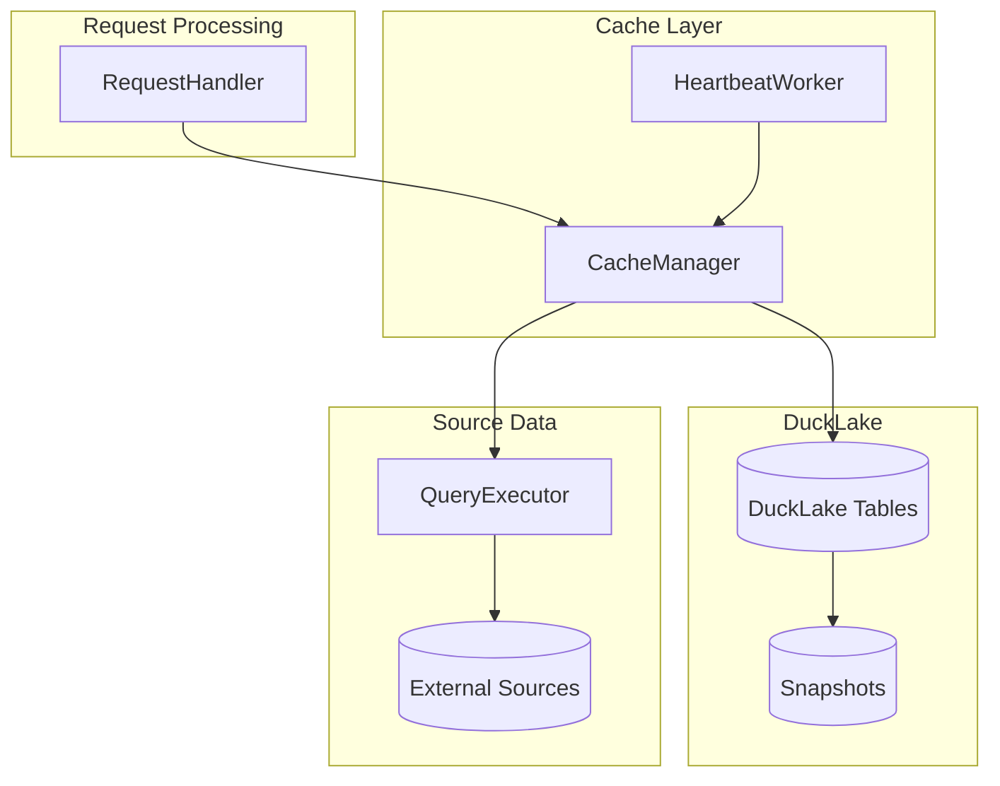
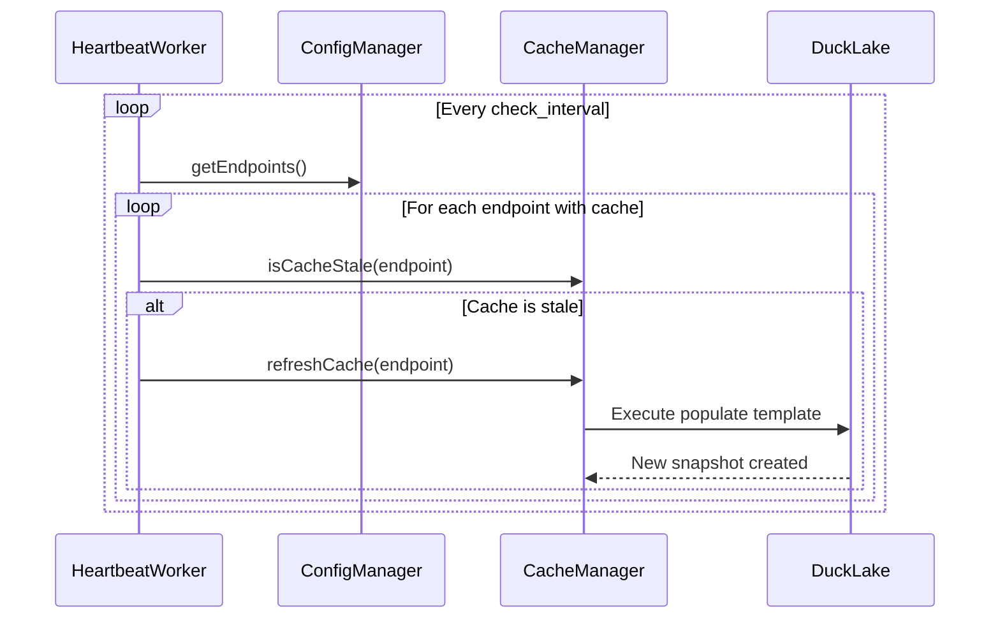
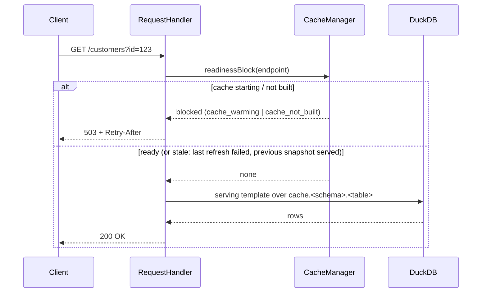

# Caching System

This document describes the DuckLake-based caching architecture in flAPI.

## Overview

flAPI uses DuckLake for result caching, providing:
- Snapshot-based table versioning
- Time-travel queries for rollback
- Efficient incremental refresh
- Scheduled background refresh

## Architecture



## CacheManager

`CacheManager` (src/cache_manager.cpp) handles all cache operations.

### Key Methods

```cpp
class CacheManager {
public:
    // Check if cache is enabled and valid
    bool isCacheEnabled(const EndpointConfig& endpoint) const;
    bool isCacheValid(const EndpointConfig& endpoint) const;

    // Cache operations
    QueryResult getCachedResult(const EndpointConfig& endpoint,
                                const std::map<std::string, std::string>& params);
    void updateCache(const EndpointConfig& endpoint, const QueryResult& result);
    bool invalidateCache(const EndpointConfig& endpoint);

    // Refresh operations
    void refreshCache(const EndpointConfig& endpoint);
    void refreshAllCaches();

    // Snapshot management
    std::vector<SnapshotInfo> getSnapshots(const std::string& table) const;
    void pruneSnapshots(const std::string& table, const RetentionConfig& retention);
};
```

## Cache Configuration

### Endpoint Cache Config

```yaml
cache:
  enabled: true
  table: customers_cache       # Cache table name
  schema: cache                # Schema (default: cache)
  schedule: "1h"               # Refresh interval
  primary-key: [id]            # For merge operations
  cursor:
    column: updated_at         # Change tracking column
    type: timestamp
  retention:
    keep-last-snapshots: 10    # Max snapshots to keep
    max-snapshot-age: "7d"     # Max age of snapshots
  invalidate-on-write: true    # Clear on write operations
  refresh-on-write: false      # Refresh after writes (REST writes only)
  template-file: customers_cache.sql  # The populate SQL
```

### Global DuckLake Config

```yaml
ducklake:
  enabled: true
  alias: cache                 # Database alias
  metadata-path: ./cache/metadata
  data-path: ./cache/data
  retention:
    keep-last-snapshots: 100
    max-snapshot-age: "30d"
  compaction:
    enabled: true
    schedule: "24h"
  scheduler:
    enabled: true
    scan-interval: "1m"
```

## Cache Modes

### Full Refresh

Replaces entire cache table on each refresh:

```sql
-- Cache populate template (full refresh)
CREATE OR REPLACE TABLE {{cache.catalog}}.{{cache.schema}}.{{cache.table}} AS
SELECT * FROM read_parquet('{{{ conn.path }}}')
```

**Use when:**
- Small datasets
- Complete data replacement needed
- Simple implementation preferred

### Incremental Append

Adds new rows since last refresh:

```sql
-- Cache populate template (incremental append)
-- First run: no watermark, so create the (empty) table before inserting.
{{^cache.previousSnapshotTimestamp}}
CREATE TABLE IF NOT EXISTS {{cache.catalog}}.{{cache.schema}}.{{cache.table}} AS
SELECT * FROM source_table WHERE false;
{{/cache.previousSnapshotTimestamp}}
INSERT INTO {{cache.catalog}}.{{cache.schema}}.{{cache.table}}
SELECT * FROM source_table
WHERE 1=1
{{#cache.previousSnapshotTimestamp}}
  AND created_at > TIMESTAMP '{{cache.previousSnapshotTimestamp}}'
{{/cache.previousSnapshotTimestamp}};
```

**Use when:**
- Append-only data (logs, events)
- Large datasets
- Fast refresh needed

### Incremental Merge

Handles inserts, updates, and deletes:

```sql
-- Cache populate template (incremental merge)
{{^cache.previousSnapshotTimestamp}}
CREATE TABLE IF NOT EXISTS {{cache.catalog}}.{{cache.schema}}.{{cache.table}} AS
SELECT * FROM source_table WHERE false;
{{/cache.previousSnapshotTimestamp}}
MERGE INTO {{cache.catalog}}.{{cache.schema}}.{{cache.table}} AS target
USING (
    SELECT * FROM source_table
    WHERE 1=1
    {{#cache.previousSnapshotTimestamp}}
    AND updated_at > TIMESTAMP '{{cache.previousSnapshotTimestamp}}'
    {{/cache.previousSnapshotTimestamp}}
) AS source
ON target.id = source.id
WHEN MATCHED THEN UPDATE SET *
WHEN NOT MATCHED THEN INSERT *
```

**Use when:**
- Rows are updated in place (customers, orders)
- Deletes are visible in the source (a soft-delete flag or `deleted_at` that
  bumps the cursor), handled with `WHEN MATCHED AND source.is_deleted THEN DELETE`.
  A hard delete leaves no row for the delta to carry, so it is invisible to
  any incremental mode.

## Cache Template Variables

| Variable | Description |
|----------|-------------|
| `{{cache.table}}` | Cache table name |
| `{{cache.schema}}` | Cache schema name |
| `{{cache.catalog}}` | Cache catalog (DuckLake alias) |
| `{{cache.previousSnapshotTimestamp}}` | Incremental watermark: `max(<cursor>)` over the cached rows when a `cursor:` is configured, else the last refresh's commit timestamp. See CONFIG_REFERENCE for why the commit timestamp alone loses rows. |
| `{{cache.snapshotTimestamp}}` / `{{cache.snapshotId}}` | The table's newest snapshot when this refresh started |
| `{{cache.previousSnapshotId}}` | Snapshot id of the last completed refresh (for time travel) |
| `{{cache.cursorColumn}}` / `{{cache.cursorType}}` | The declared cursor |
| `{{cache.primaryKeys}}` | The declared primary key, comma-joined |
| `{{cache.schedule}}` | The declared schedule |
| `{{params.cacheMode}}` | `full`, `append` or `merge` |

## HeartbeatWorker

`HeartbeatWorker` (src/heartbeat_worker.cpp) runs background cache refresh.

### Two background paths, both direct

The worker loop drives two independent things per tick, and **neither goes
through the HTTP router**:

| Path | Entry point | Applies to |
|------|-------------|------------|
| Endpoint warm-up | `APIServer::warmEndpoint()` → `RequestHandler::handleRequest()` | every endpoint with `heartbeat.enabled: true`, cached or not |
| DuckLake schedule | `CacheManager::refreshCache()` | every endpoint with `cache.schedule` |

The warm-up runs the endpoint's whole read path as a synthetic GET (connection,
extensions, template render, query) and discards the result, so a cache-backed
endpoint is refreshed and an uncached one is merely warmed. It passes
`endpoint.heartbeat.params` as the template parameters.

`warmEndpoint()` replaced `requestForEndpoint()`, which synthesised a
`crow::request` and called `app.handle_full()`. A synthesised request has a null
`io_service` and a null `middleware_context`, and routing one dereferenced both
— twice, in the handler offload and then in `handleDynamicRequest()` (#141).
`scripts/check_no_synthetic_router_entry.sh` now fails the build if a
`handle_full()` call reappears in `src/`.

### Initialization

```cpp
class HeartbeatWorker {
public:
    HeartbeatWorker(std::shared_ptr<ConfigManager> config_manager,
                    std::shared_ptr<CacheManager> cache_manager);

    void start();
    void stop();

private:
    void workerLoop();
    void checkAndRefreshCaches();

    std::thread worker_thread;
    std::atomic<bool> running;
    std::chrono::seconds check_interval;
};
```

### Refresh Logic



### Schedule Parsing

```cpp
// Parses interval strings like "1h", "30m", "6h"
std::chrono::seconds CacheConfig::getRefreshTimeInSeconds() const {
    return TimeInterval::parseInterval(schedule.value_or("1h"));
}
```

Supported formats:
- `30s` - 30 seconds
- `5m` - 5 minutes
- `1h` - 1 hour
- `24h` - 24 hours

## Snapshot Management

### Creating Snapshots

```sql
-- DuckLake creates snapshot automatically on data changes
INSERT INTO cache.customers_cache SELECT ...;
-- New snapshot created with timestamp
```

### Time-Travel Queries

```sql
-- Query specific snapshot
SELECT * FROM cache.customers_cache
AS OF TIMESTAMP '2024-01-15 10:30:00';

-- Query by snapshot version
SELECT * FROM cache.customers_cache VERSION AS OF 5;
```

### Snapshot Pruning

```cpp
void pruneSnapshots(const std::string& table, const RetentionConfig& retention) {
    if (retention.keep_last_snapshots.has_value()) {
        // Keep only last N snapshots
        deleteOldSnapshots(table, *retention.keep_last_snapshots);
    }
    if (retention.max_snapshot_age.has_value()) {
        // Delete snapshots older than max age
        deleteSnapshotsOlderThan(table, *retention.max_snapshot_age);
    }
}
```

## Cache Invalidation

Caches can be invalidated:

### On Write Operations

```yaml
cache:
  invalidate-on-write: true  # Clear cache after writes
  refresh-on-write: true     # Or immediately refresh (REST writes; MCP writes only invalidate)
```

### Via API

```bash
# Force cache refresh
POST /api/v1/_config/endpoints/{path}/cache/refresh

# Expire old snapshots per the endpoint's retention policy
POST /api/v1/_config/endpoints/{path}/cache/gc
```

### Programmatic

```cpp
cache_manager->invalidateCache(endpoint);
```

## Request Flow with Cache

A cached endpoint's serving template reads the cache table. There is no
per-request hit/miss decision and no fallback to the source: a request either
reads the materialised table or, while the table is not ready, gets a 503 (see
below).



Refreshes run off the request path (warm-up, HeartbeatWorker schedule, config
service / `flapii cache refresh`, `flapi cache refresh`). Each one writes a row to
`<alias>.audit.sync_events` with `duration_ms`, `rows_affected` and
`snapshot_id`, and updates the in-memory roll-up served under `caches` by
`GET /api/v1/_config/metrics`.

## Readiness during warmup

There is **no per-request cache hit/miss check**. The cache is a materialised
DuckLake table that the endpoint's template queries directly; a cached endpoint
runs the same SQL path as any other.

What does happen per request is a readiness check. While a cache table is still
warming, `CacheManager::readinessBlock` short-circuits
`RequestHandler::handleRequest` with a 503 and a `Retry-After` header, rather
than serving an empty table as though it were an empty result.

### Readiness states

| State | Set when | Request path | `/health` |
|---|---|---|---|
| `Starting` | before warm-up reaches the cache | `503 cache_warming` | `503 starting` |
| `Ready` | a refresh succeeded, or warm-up was skipped and the table exists | served | `200 ready` (or `degraded` + `stale` after a failed refresh) |
| `Failed` | the first build failed | `503 cache_warming` | `503 degraded` |
| `Unbuilt` | warm-up was skipped (`never`, `read-only`) and the table does not exist | `503 cache_not_built` | `200 degraded`, `unbuilt` list |

The warm-up mode for an endpoint is resolved by
`ConfigManager::getEffectiveCacheWarmupMode`. The order is: `ducklake.read-only`,
then the CLI/env override, then `cache.warmup`, then `ducklake.warmup`.
"Table exists" is a lookup in `duckdb_tables()` for the catalog alias, so on a
`:memory:` database `if-empty` behaves like `always`.

## Writer and readers

`flapi cache refresh` (`src/cache_refresh_command.cpp`) is the writer. It runs
`CacheManager::refreshCache` for the selected endpoints and exits.
Replicas set `ducklake.read-only: true`. The catalog is then attached
`READ_ONLY`, `HeartbeatWorker::ShouldRunCacheMaintenance` returns false (no
scheduled refresh, retention or compaction), and `CacheConfigHandler` answers
`409 read_only_cache` to refresh, update and GC.

## Source Files

| File | Purpose |
|------|---------|
| `src/cache_manager.cpp` | Cache operations |
| `src/heartbeat_worker.cpp` | Background refresh scheduler |
| `src/include/config_manager.hpp` | CacheConfig, DuckLakeConfig structs |

## Related Documentation

- [DESIGN_DECISIONS.md](../DESIGN_DECISIONS.md#5-ducklake-for-caching) - Why DuckLake
- [query-execution.md](./query-execution.md) - Query execution details
