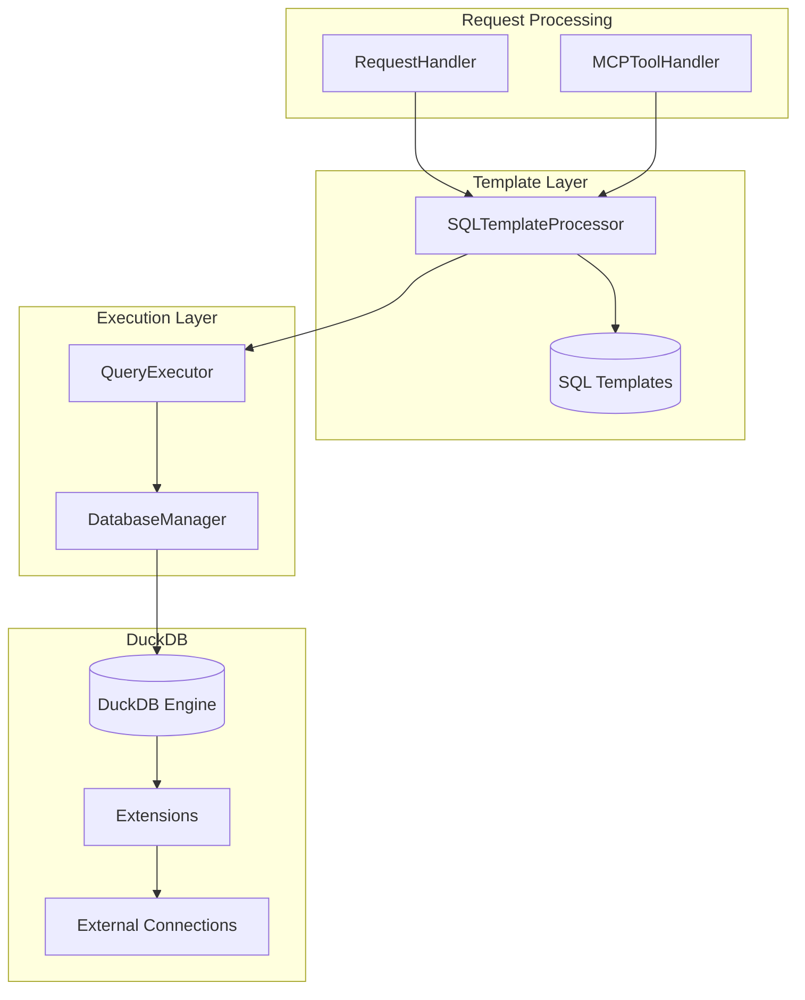
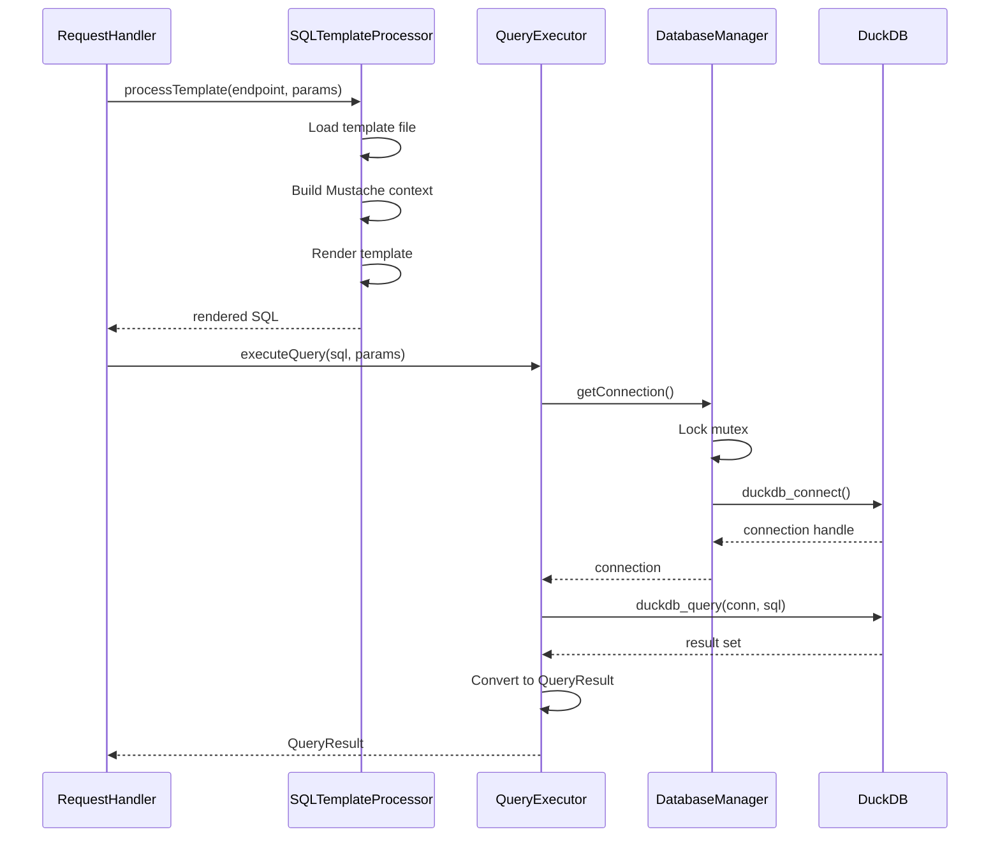

# Query Execution

This document describes the SQL template processing and query execution architecture in flAPI.

## Overview

Query execution involves:
1. Loading SQL templates from disk
2. Expanding Mustache templates with request parameters
3. Executing queries on DuckDB
4. Formatting results for API responses

## Architecture



## SQLTemplateProcessor

`SQLTemplateProcessor` (src/sql_template_processor.cpp) handles Mustache template expansion.

### Template Context

Templates have access to these variables:

| Variable | Description | Example |
|----------|-------------|---------|
| `params.*` | Request parameters | `params.id`, `params.status` |
| `conn.*` | Connection properties | `conn.path`, `conn.host` |
| `env.*` | Environment variables | `env.API_KEY` |
| `cache.*` | Cache metadata | `cache.table`, `cache.previousSnapshotTimestamp` |
| `auth.*` | Auth context | `auth.username`, `auth.roles`, `auth.email`, `auth.type` |

### Template Syntax

**Triple Braces (raw text, no escaping):**
```sql
-- Inserts the value as-is; quotes are NOT doubled
WHERE name = '{{{ params.name }}}'
-- Input: O'Brien → Output: 'O'Brien'  (a syntax error; a crafted value is injection)
```
Only the validator (and the SQL-injection screen) stands between the value and the SQL here
- *where the site stays raw*. For a typed field outside every section, a plain value site
(`= {{{ params.x }}}`, `= '{{{ params.x }}}'`, `LIKE '%{{{ params.x }}}%'`) is bound like a
double-brace one (`?`, `?`, `('%' || ? || '%')`); inside sections, SQL comments, enum identifiers, typed
literals (`DATE '...'`), names after `FROM`/`JOIN`/..., and `AT (VERSION|TIMESTAMP => ...)` it is raw.

**Double Braces (bound or quote-doubled):**
```sql
-- Outside a section, on a field with a typed validator, at a value site: replaced by `?` and bound
WHERE id = {{ params.id }}
WHERE name = '{{ params.name }}'          -- the whole literal becomes ?
-- Inside a {{#...}} section, or without a typed validator: text, single quotes doubled
-- Input: O'Brien → Output: O''Brien
```

`SQLTemplateProcessor::compileTemplate` sets that escape on crow's `template_t`
(`EscapeSqlTemplateValue`, through the `ports/crow/settable-mustache-escape.patch`
overlay); crow's default HTML escaping stays for the Swagger UI page.

**Conditional Sections:**
```sql
{{#params.id}}
  -- Rendered if params.id exists and is truthy
  AND id = {{{ params.id }}}
{{/params.id}}

{{^params.id}}
  -- Rendered if params.id does NOT exist
  AND id IS NULL
{{/params.id}}
```

**Default Values:**
```sql
AND region = '{{#params.region}}{{{ params.region }}}{{/params.region}}{{^params.region}}EU{{/params.region}}'
```
`limit`/`offset` are reserved for pagination (`with-pagination`, on by default); a template
`LIMIT {{ params.limit }}` runs before flAPI's offset and breaks paging.

### Processing Flow

```cpp
std::string processTemplate(const EndpointConfig& endpoint,
                            std::map<std::string, std::string>& params) {
    // 1. Load template file
    std::string template_content = loadTemplateFile(endpoint.templateSource);

    // 2. Build context
    auto context = buildContext(endpoint, params);

    // 3. Render Mustache template
    return mustache::render(template_content, context);
}
```

A local template file is read once and cached by path (`loadTemplateShared`); every
render revalidates the entry with one `stat` (device, inode, size, mtime, ctime) and
re-reads on any difference, so an edited file is served by the next request. That
stat costs ~0.2 us, the read it replaces (four existence stats, open, read, copies)
~2.5 us. Two same-size writes within one filesystem timestamp tick leave the same
stamp, so every write flAPI makes itself (config service template PUT, endpoint
create/update, any reload) drops the whole cache (`clearTemplateCache`); only an
external editor writing twice within one tick can be missed, until the next change
or reload. On Windows the stamp is size, last-write time (100 ns) and creation time
(`GetFileAttributesEx`; there is no inode); the filesystem's own timestamp
resolution still applies (FAT: 2 s). Templates in a bundle are already in memory; remote templates are fetched
per render as before.

## QueryExecutor

`QueryExecutor` (src/query_executor.cpp) executes SQL against DuckDB.

### Query Methods

```cpp
// Execute read query with optional pagination
QueryResult executeQuery(const std::string& query,
                        const std::map<std::string, std::string>& params,
                        bool with_pagination = true);

// Execute query against cache tables (DuckLake)
QueryResult executeDuckLakeQuery(const std::string& query,
                                 const std::map<std::string, std::string>& params);

// Execute write operation
WriteResult executeWrite(const EndpointConfig& endpoint,
                        std::map<std::string, std::string>& params);
```

### QueryResult Structure

```cpp
struct QueryResult {
    std::vector<std::string> columns;
    std::vector<std::vector<std::string>> rows;
    int64_t total_rows;
    bool from_cache;

    crow::json::wvalue toJson() const;
};
```

**Template syntax check** (`src/mustache_syntax_check.cpp`): the bundled crow Mustache parser has no
balance checks of its own - a stray `{{/x}}` crashed the process (SIGSEGV) and an unclosed `{{#x}}` with
`x` absent looped forever while memory grew. Every template is therefore checked before crow compiles
it: at load and reload (`EndpointConfigParser`), in `--validate-config`, on a config-service template
update, and on every render (`SQLTemplateProcessor::compileTemplate`, since a template is re-read from
disk per request). Rejected: unbalanced or crossed sections, `{{{` not closed by `}}}`, an unterminated
`{{`, empty tags and section names, partials (`{{> x}}`) and set-delimiter tags (`{{= =}}`). Errors read
`Invalid template <file>:<line>:<col>: <what>`; at request time the answer is a 500.

**JSON values** (`QueryResult::decimalToJson`, `convertVectorTimestampToJson`):

- `DECIMAL` is rendered from DuckDB's exact text, not through `double`: scale 0 with at most 18 digits
  becomes a JSON integer; a value with at most 15 significant digits becomes the exact JSON number
  (`7790.62`, not `7790.61999999999989086`). A wider value (`DECIMAL(38,9)`, more than 15 digits in all) is
  emitted as the exact **string** (`"12345678901234567890.123456789"`): crow's `wvalue` cannot carry a raw
  number token, and a double would change digits. Only those values change JSON type.
- The session `TimeZone` is pinned to `UTC` (or `duckdb.TimeZone`) at startup (`DatabaseManager::applyTimeZone`),
  so `now()::TIMESTAMP`, `date_trunc` and `TIMESTAMPTZ` -> `TIMESTAMP` do not follow the host `TZ`.
- Debug logs never contain connection credentials: the template context is not dumped and the rendered SQL is
  scrubbed of every connection's credential-valued properties (`SQLTemplateProcessor::processTemplate`).
- `TIMESTAMP` / `TIMESTAMPTZ` keep microseconds; `TIMESTAMP_S` and `TIMESTAMP_MS` are decoded in their
  own unit, `TIMESTAMP_NS` keeps 9 fractional digits; DuckDB's infinities become the strings
  `"infinity"` / `"-infinity"`. Only `TIMESTAMPTZ` (an instant, stored as UTC) carries the `Z`
  (`2024-01-01T10:00:00.123456Z`); the naive `TIMESTAMP` family has no zone and none is printed
  (`2024-01-01T10:00:00.123456`).
- `DOUBLE` / `FLOAT` are printed in their shortest round-trip form (`711.56`, not
  `711.55999999999994543`; a `FLOAT` `0.1` is `0.1`); an integral value keeps `.0`.
- Row objects list their keys in `SELECT` column order, in JSON (REST, MCP `tools/call`,
  `resources/read`) and CSV alike (`QueryResult::dumpData`, which every response path uses instead of
  `crow::json::wvalue::dump`: a crow object is an unordered map).
- SQL `NULL` is JSON `null`.

### WriteResult Structure

```cpp
struct WriteResult {
    int64_t rows_affected = 0;
    std::optional<crow::json::wvalue> returned_data;  // For RETURNING clauses
    std::string last_insert_id;
};
```

## DatabaseManager

`DatabaseManager` (src/database_manager.cpp) is a singleton that manages DuckDB connections.

### Singleton Pattern

```cpp
class DatabaseManager : public std::enable_shared_from_this<DatabaseManager> {
public:
    static std::shared_ptr<DatabaseManager> getInstance();

    DatabaseManager(const DatabaseManager&) = delete;
    DatabaseManager& operator=(const DatabaseManager&) = delete;

private:
    duckdb_database db;
    std::mutex db_mutex;
};
```

### Initialization

```cpp
void initializeDBManagerFromConfig(std::shared_ptr<ConfigManager> config_manager) {
    // 1. Create DuckDB config
    createAndInitializeDuckDBConfig(config_manager, config);

    // 2. Open database (file or in-memory)
    duckdb_open_ext(db_path.c_str(), &db, config, nullptr);

    // 3. Load default extensions
    loadDefaultExtensions(config_manager);

    // 4. Initialize connections
    initializeConnections(config_manager);
}
```

### Connection Initialization

For each connection in `flapi.yaml`, DatabaseManager executes initialization SQL:

```yaml
connections:
  postgres-db:
    init: |
      INSTALL postgres;
      LOAD postgres;
      ATTACH 'host=localhost dbname=mydb' AS pg (TYPE postgres);
    properties:
      host: localhost
      database: mydb
```

### Thread Safety

All DuckDB operations are protected by a mutex:

```cpp
duckdb_connection getConnection() {
    std::lock_guard<std::mutex> lock(db_mutex);
    duckdb_connection conn;
    duckdb_connect(db, &conn);
    return conn;
}
```

## DuckDB Extensions

flAPI supports all DuckDB extensions. Common ones:

| Extension | Purpose | Auto-loads for |
|-----------|---------|---------------|
| `json` | JSON functions | `.json` files |
| `parquet` | Parquet files | `.parquet` files |
| `httpfs` | HTTP/S3/GCS access | `s3://`, `https://` |
| `postgres_scanner` | PostgreSQL | `ATTACH ... TYPE postgres` |
| `sqlite_scanner` | SQLite files | `sqlite_scan()` |
| `excel` | Excel files | `.xlsx` files |

Extensions are loaded on-demand or explicitly:

```yaml
duckdb:
  default_extensions:
    - json
    - httpfs
    - postgres
```

## Query Execution Flow



## Pagination

Read queries can include automatic pagination:

```cpp
QueryResult executeQuery(const std::string& query,
                        const std::map<std::string, std::string>& params,
                        bool with_pagination = true);
```

Pagination params:
- `_limit` - Maximum rows to return
- `_offset` - Rows to skip

`total_count` comes from the page when it can (no window, or a short page); otherwise a
`COUNT(*)` over the query runs - except on a DuckLake-cached endpoint whose query reads
only DuckLake tables, where the count is reused until the catalog's next snapshot
(`CountCache`, see [caching.md](./caching.md#total_count-of-a-cached-endpoint-242)).

## Write Operations

Write operations have additional features:

```yaml
operation:
  type: Write
  transaction: true          # Wrap in BEGIN/COMMIT
  returns-data: true         # Expect RETURNING clause
  validate-before-write: true
```

`POST`, `PUT`, `PATCH` and `DELETE` all take this path (`RequestHandler` → `executeWrite`): parameters
are extracted and validated, the template is rendered, the statements run, and the response is
`{"rows_affected": n}` or the `RETURNING` rows. `DELETE` used to bypass it (cache invalidation or `405`).

After a successful write to an endpoint with a cache, `cache.invalidate-on-write` refreshes the cache
synchronously before the response; `cache.refresh-on-write` schedules an asynchronous refresh after the
response, coalesced per endpoint; with both set only the synchronous refresh runs. MCP tool writes use
the same rules.

A failure anywhere here is answered with the generic `500` body and a `request_id`; the DuckDB error is
logged under that id (see [security.md](./security.md#error-responses)).

```cpp
WriteResult executeWriteInTransaction(const EndpointConfig& endpoint,
                                      std::map<std::string, std::string>& params) {
    auto executor = createQueryExecutor();
    executor.beginTransaction();
    try {
        auto result = executeWrite(executor, endpoint, params);
        executor.commit();
        return result;
    } catch (...) {
        executor.rollback();
        throw;
    }
}
```

## Instrumentation

Two inner spans are emitted when tracing is enabled, parented by OpenTelemetry's
thread-local active-span stack — which is why no signature in this component
changed to carry a span around.

| Span | Kind | Emitted from |
|---|---|---|
| `flapi.render_template` | INTERNAL | `src/sql_template_processor.cpp` |
| `duckdb.query` | CLIENT | `src/query_executor.cpp` (`startDbSpan`) |

Attributes are structural only: the template's **basename** and size, the count
of bound parameters, the SQL **verb** in `db.operation.name`, and rows returned.
The rendered SQL itself is not exported.

Both execution paths are spanned. The span lives in `executePrepared` rather than
in `executeWithBindings`, because that is the one choke point both callers reach —
`executeWithBindings` delegates to it, and `DatabaseManager` calls it directly for
extracted init statements. Spanning in both places would double-count every typed
endpoint. `executePrepared` takes the statement text purely to derive the
allowlisted verb; the prepared handle does not carry it, and it is never exported.

### Execution profiling

With `tracing.db_profiling` set, DuckDB's own execution metrics are attached to
the database span (`flapi.db.*`). Three things shape the implementation:

- **The settings are connection-scoped.** `enable_profiling` and
  `tracked_metrics` (DuckDB 2.0; it replaced `custom_profiling_settings` and takes metric names
  such as `query.total_time`) are `SetLocal` only — there is no global setter, so
  they cannot be applied at `duckdb_open`, so each profiled query pays a `SET`.
  Measured at ~106 µs, which is nearly all of the feature's cost. Request threads
  otherwise reuse their connection (and its prepared SELECTs); a profiled
  connection is retired after the query instead, so profiling never leaks.
- **Two statements in one round trip, and the order matters.**
  `tracked_metrics` turns the metrics on but leaves
  `emit_profiler_output` at its default of **true**, so DuckDB renders and prints
  a ~1 KB query tree to stderr for every profiled query — a synchronous write on
  the request thread, and operator detail landing in a log that never passes
  through the capture tiers. `SET enable_profiling='no_output'` is sent first to
  clear that; the second statement then replaces the metric set. An integration
  test asserts the log stays clean.
- **The two tiers are a verbosity knob, not a cost knob.** `ProfilingInfo::Expand`
  means requesting `CPU_TIME` also enables `OPERATOR_TIMING` internally, so the
  original expectation was that `summary` would be measurably cheaper. Measured
  interleaved, it is not: the two are indistinguishable (`detailed` even measures
  slightly lower, i.e. within noise). The tiers are worth keeping because
  attribute count has a real cost in a trace backend, not because one is faster.

Metrics are read through a fixed allowlist in `src/query_executor.cpp`. The code
must never iterate `duckdb_profiling_info_get_metrics()`: `QUERY_NAME` is the SQL
text and `EXTRA_INFO` is the rendered filter predicate. Each
`duckdb_profiling_info_get_value` result is owned by the caller and released by
`DuckDBValue` (`src/include/duckdb_raii.hpp`); the `duckdb_profiling_info` node
itself is owned by the connection and has no destructor. Each read is wrapped in
try/catch so a future DuckDB changing a metric's type cannot fail a request, and
a failed `SET` latches process-wide so it warns once rather than once per query.

`db.operation.name` on the prepared path comes from
`duckdb_prepared_statement_type` on the handle rather than from the SQL text —
exact rather than a leading-token guess, correct for the startup init statements
that have no text at the call site, and structurally incapable of exporting SQL.

This thread-local parenting works only within one thread. Background work —
cache refresh, warmup, heartbeat, MCP tasks — must start **root** spans, because
the ambient context there is either absent or stale from an unrelated request.

## Source Files

| File | Purpose |
|------|---------|
| `src/sql_template_processor.cpp` | Mustache template processing |
| `src/query_executor.cpp` | Query execution |
| `src/database_manager.cpp` | DuckDB connection management |
| `src/include/database_manager.hpp` | Struct definitions |

## Related Documentation

- [DESIGN_DECISIONS.md](../DESIGN_DECISIONS.md#1-singleton-pattern-for-databasemanager) - Why singleton
- [DESIGN_DECISIONS.md](../DESIGN_DECISIONS.md#4-mustache-for-sql-templates) - Why Mustache
- [caching.md](./caching.md) - Cache query execution
